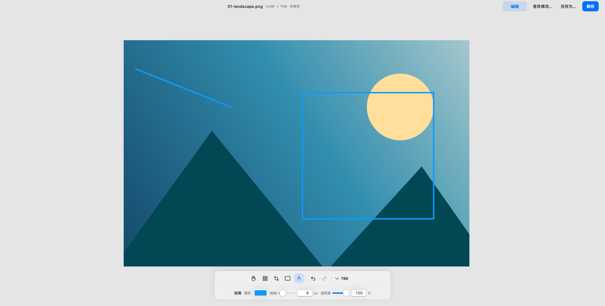

# PicGlide


轻量的 macOS 图片浏览与标注工具。

[下载最新版](https://github.com/wsfwsfwsf2017-gif/PicGlide/releases/latest) · [历史版本](https://github.com/wsfwsfwsf2017-gif/PicGlide/releases) · [更新记录](CHANGELOG.md)



## 功能

- 拖动平移、鼠标位置缩放、触控板捏合，方向键或左右边缘的悬浮按钮浏览同目录图片。
- 圆形马赛克画笔、可调整选区的裁剪、矩形标注和自由铅笔，支持撤销与重做。
- 原格式保存，或另存为 PNG、JPEG、WebP。
- 浅色与深色外观、全屏浏览，以及闲置时自动收起的浮动工具栏。
- 支持 JPG、PNG、WebP、HEIC/HEIF、BMP、TIFF 和 GIF 首帧。

GIF 等多帧图片编辑后需另存为静态图片。覆盖保存会改写原文件；重新编码可能损失画质及部分元数据。

## 下载与安装

需要 **macOS 14 或更新版本、Apple Silicon（M 系列芯片）**。

在 [Releases](https://github.com/wsfwsfwsf2017-gif/PicGlide/releases/latest) 下载对应版本的 `.dmg`，打开后将 PicGlide 拖入 Applications；也可下载 `.zip` 并解压安装。每个版本提供 SHA-256 校验文件。

当前安装包未使用 Developer ID 签名和 Apple 公证。首次打开若被系统拦截，确认下载来源后，可在“系统设置 → 隐私与安全性”中选择“仍要打开”。[Apple 说明](https://support.apple.com/en-gb/102445)

## 常用操作

| 操作 | 快捷键／手势 |
| --- | --- |
| 打开图片 | `⌘O`、拖入窗口或 Finder 打开方式 |
| 上一张／下一张 | `←` `↑` ／ `→` `↓` |
| 平移／缩放 | 左键拖动／滚轮或触控板捏合 |
| 适应窗口／原始尺寸 | `⌘0` ／ `⌘1` |
| 展开／收起编辑工具 | `⌘E` |
| 编辑时临时平移 | 按住空格拖动 |
| 裁剪／取消裁剪 | `↵` ／ `Esc` |
| 撤销／重做 | `⌘Z` ／ `⇧⌘Z` |
| 保存／另存为 | `⌘S` ／ `⇧⌘S` |
| 全屏 | `⌃⌘F` |

“编辑”仅展开或收起工具，保留未保存修改；“保存”写入当前文件，保存后可继续编辑；“另存为…”成功后以新文件继续操作。“舍弃修改…”经确认后恢复到上次保存，舍弃的修改无法撤销。

裁剪选区需点击“裁剪”或“取消裁剪”后再保存、切换工具或翻图。离开有未保存修改的图片时，会提示保存、不保存或取消；有待确认裁剪时，需继续编辑或明确舍弃全部未保存修改。

## Agent 调用

支持本地命令行查询图片信息、裁剪、马赛克、画框和铅笔操作，返回 JSON，仅生成新文件。调用方式见 [Agent 使用说明](docs/agent.md)。

## 本地构建

使用 Swift 6 和 Xcode Command Line Tools，首次构建由 SwiftPM 获取依赖。

```sh
./scripts/build-app.sh
# 测试完成后更新 /Applications/PicGlide.app，并清理构建目录的展开副本
```

运行测试：`./scripts/test.sh`。制作安装包：`./scripts/package-release.sh`。

版本采用 `主版本.次版本.修订版本`，以 `Resources/Info.plist` 为准。更新版本与变更记录后，推送对应的 `vX.Y.Z` 标签，GitHub Actions 自动验证、打包并发布 Release。

## 许可证

PicGlide 使用 [MIT 许可证](LICENSE)。WebP 编码依赖 [libwebp-Xcode / libwebp](https://github.com/SDWebImage/libwebp-Xcode)，使用 BSD-3-Clause 许可证；相关版权声明随 App 分发。
